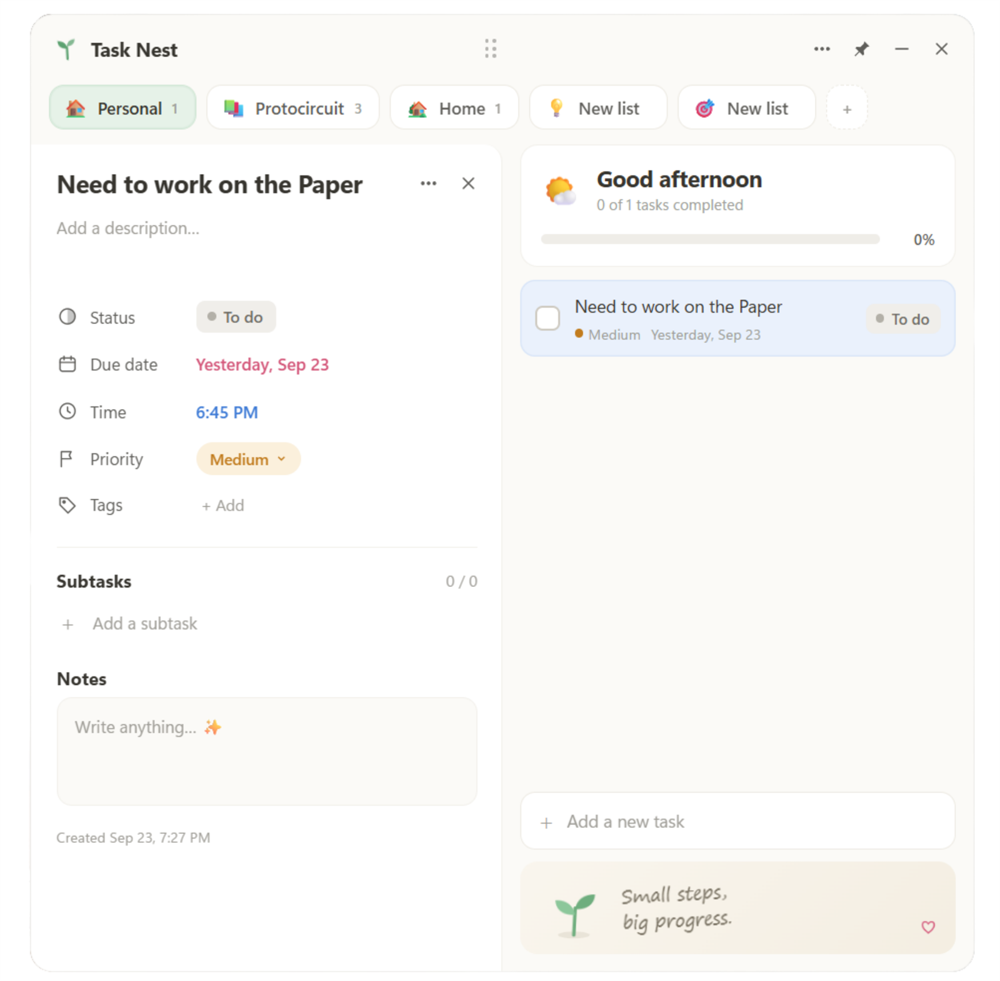

<div align="center">



# 🌱 Task Nest

**A free, self-hosted, Notion-style task manager that lives as a cute little widget on your desktop.**
No account. No subscription. No server. Just your tasks, on your machine.

[](../../releases/latest)
[](LICENSE)
[](#%EF%B8%8F-install)

</div>

---

Most to-do apps live in a browser tab you forget about, or a mobile app you never open. **Task Nest sits right on your desktop like a sticky note**: a small, always-there widget with lists, task statuses, priorities and a Notion-style detail view, without the sign-ups, sync fees or bloat.

It's a **free and open-source alternative** to paid task widgets and desktop sticky-note apps, built for people who want a simple task manager that keeps their data local. It is a single Electron app of plain HTML, CSS and JavaScript (no framework, no build step to run it), and it never makes a network request.

## Contents

- [Features](#-features)
- [Screenshots](#-screenshots)
- [Install](#%EF%B8%8F-install)
- [Using it](#%EF%B8%8F-using-it)
- [Your data, your machine](#-your-data-your-machine)
- [How it works](#-how-it-works)
- [Running from source](#%EF%B8%8F-running-from-source)
- [Project structure](#-project-structure)
- [Configuration](#%EF%B8%8F-configuration)
- [Roadmap](#%EF%B8%8F-roadmap)
- [License](#license)

## ✨ Features

**A widget, not a window**
- Frameless, transparent widget that docks to the top-right of your screen and hides from the taskbar
- Opens with Windows (on by default from the first launch; toggle it from the **⋯** menu or the tray)
- **Mini mode**: collapse to just the header bar (button or double-click the header), showing how many tasks are left
- **Pin** to keep it above other apps, or leave it unpinned so other windows can cover it (the default)
- Global shortcut **Alt + Shift + T** and a tray icon to show or hide it
- Remembers its position, and only restores it if that spot is still on a connected screen
- The detail panel opens to whichever side of the widget has room

**Notion-style tasks**
- Every task has a **status** (To do, In progress, Completed), due **date** and **time**, **priority** (High, Medium, Low, None), **tags**, **subtasks**, a description and **notes**
- Built-in date and time pickers; overdue dates are highlighted
- Quick add understands times and priorities: `Gym 6pm`, `Standup at 9:30am`, `Review 17:00`, `Pay rent !high`, `Email Sam !low`
- Right-click a task to change status or priority, duplicate it, move it to another list, or delete it
- Deleting a task or clearing completed tasks shows an **Undo** toast

**Smart, automatic sorting**
- To do first, then In progress; inside each, High → Medium → Low → none; then the order you added them
- Completed tasks collapse into a **Completed** section at the bottom of each list
- A small celebration when you complete a task, and a "You bloomed today" message when a list is done

**Lists you control**
- Add, rename, delete and re-icon lists (18 emoji icons)
- Drag tabs to reorder them, or right-click → Move left / right
- Starts with Work, Personal, Study and Home lists plus a few example tasks

**Little touches**
- A greeting that follows the time of day
- **7 animated footer scenes** (sprout, sun, coffee, night, cactus, peaks, tulip), one per day, each with its own motivational line
- Keyboard: **Ctrl + N** focuses the add box, **Esc** closes menus and the detail panel

**Your data stays yours**
- Saved locally to a plain JSON file, with automatic backups
- No account, no sign-up, no telemetry, no network access (the page's Content Security Policy only allows local resources)

## 📸 Screenshots


## ⬇️ Install

**[Download the latest installer](../../releases/latest)** → run `Task-Nest-Setup-x.x.x.exe` → done.

- Installs for your user account (no admin rights needed)
- Adds a Desktop and Start Menu shortcut, and launches when setup finishes
- Starts automatically when Windows starts (toggle any time from the **⋯** menu)
- Windows SmartScreen may warn you because the app isn't code-signed yet: click **More info → Run anyway**

Currently Windows only (x64). macOS/Linux builds are welcome as a PR: the app is plain Electron, so it should package with minimal changes.

## 🖱️ Using it

| Action | How |
|---|---|
| Switch lists | Click a tab |
| Reorder lists | Drag a tab, or right-click → Move left/right |
| Rename, re-icon or delete a list | Right-click the tab |
| Add a list | Click **+** next to the tabs |
| Add a task | Type in the box and press Enter (or **Ctrl + N** to jump there) |
| Set a time while adding | End the title with `6pm`, `at 9:30am` or `17:00` |
| Set a priority while adding | Add `!high`, `!med`, `!medium` or `!low` |
| Open task details | Click a task |
| Change status | Click the status pill, on the task or in its details |
| More task actions | Right-click a task (duplicate, move to list, priority, delete) |
| Reorder tasks | They sort themselves: To do first, then In progress, high priority on top |
| See completed tasks | Click **Completed** at the bottom of a list |
| Clear completed tasks | **⋯** menu → Clear completed in this list |
| Collapse to the header | Click **–** or double-click the top bar |
| Move the widget | Drag the top bar |
| Keep it on top of other windows | Click the pin 📌 |
| Show / hide | **Alt + Shift + T**, or click the tray icon |
| Put it back in the corner | Tray menu → Reset position |
| Quit | **⋯** menu → Quit, or tray menu → Quit (closing the window only hides it) |

## 🔒 Your data, your machine

Everything is saved to `%APPDATA%\Task Nest\tasknest.json` as you go (writes are debounced by 250 ms and flushed when the app quits or Windows signs out). Nothing leaves your machine.

- A rolling backup (`tasknest.bak.json`) is made every time the app starts, plus one dated backup per day for the last 7 days in `%APPDATA%\Task Nest\backups\`
- **⋯** menu → **Open data & backups folder** takes you straight there
- Uninstalling does **not** delete your tasks
- If the data file exists but can't be read, Task Nest tries the temp file and the rolling backup, and if all fail it shows an error instead of overwriting your file with a fresh one

## 🧠 How it works

Task Nest is a standard three-part Electron app.

```
 ┌────────────────────────── main.js (main process) ──────────────────────────┐
 │  BrowserWindow (frameless, transparent)   Tray + menu   Alt+Shift+T hotkey │
 │  Window sizing: collapsed 400px / expanded 780px / mini 78px tall          │
 │  Persistence: tasknest.json, window.json, backups/, nest.log (userData)    │
 │  Auto-start: app.setLoginItemSettings   Single-instance lock               │
 └──────────────▲───────────────────────────────────────────────┬─────────────┘
                │ ipcMain handlers (data:*, win:*, app:*)        │ 'pinned-changed'
 ┌──────────────┴──────────── preload.js ───────────────────────▼─────────────┐
 │  contextBridge exposes window.nest = { load, save, saveSync, setExpanded,  │
 │  setMini, togglePin, getAutoStart, setAutoStart, openData, quit, ... }     │
 └──────────────▲─────────────────────────────────────────────────────────────┘
                │
 ┌──────────────┴──────── src/ (renderer: index.html, app.js, styles.css) ────┐
 │  State object S { version, activeCat, categories[], tasks[] }              │
 │  Tabs, task list, detail panel, menus, pickers, toasts, footer scenes      │
 │  persist() → debounced window.nest.save(S)                                 │
 └────────────────────────────────────────────────────────────────────────────┘
```

**Main process (`main.js`)**
- Creates the widget window with `contextIsolation: true` and `nodeIntegration: false`, and resizes it as the detail panel opens (to the right if it fits on that screen, otherwise to the left) and in mini mode.
- Owns all file access. Writes go to a `.tmp` file and are renamed into place; every file operation is retried with backoff because antivirus or indexing can briefly lock files right after Windows sign-in. If the rename stays blocked it falls back to writing in place.
- Validates data before saving (it must contain `categories` and `tasks` arrays) and rejects anything else.
- Keeps a small log (`nest.log`, rotated at 256 KB) for diagnosing start-up problems.
- Reloads the renderer if the preload bridge is missing or the renderer process dies, so the UI never runs without the ability to save.
- On first launch enables "Start with Windows"; if you move from a dev copy to the installed app it re-points start-up to the installed exe.

**Preload (`preload.js`)** exposes a minimal `window.nest` API over IPC; the renderer has no Node access.

**Renderer (`src/app.js`)** holds the whole app state in one object, renders it with template strings, and calls `persist()` after every change. Task rows animate into their new sorted positions. When opened in a normal browser (outside Electron) it falls back to `localStorage`, which is handy for previewing UI changes.

**Data model** (`tasknest.json`):

```json
{
  "version": 1,
  "activeCat": "<category id>",
  "categories": [{ "id": "…", "name": "Work", "icon": "💼" }],
  "tasks": [{
    "id": "…", "catId": "…", "title": "Finish project proposal",
    "status": "todo | progress | done", "done": false, "doneAt": null,
    "date": "2026-09-24", "time": "11:00", "priority": "high | medium | low | none",
    "desc": "", "notes": "", "tags": ["Work"],
    "subtasks": [{ "id": "…", "text": "Outline key points", "done": true }],
    "createdAt": 1727170000000
  }]
}
```

## 🛠️ Running from source

**Requirements:** [Node.js](https://nodejs.org/) (with npm) and Windows for the installer build. No environment variables, API keys or accounts are needed.

```bash
git clone https://github.com/GovinduSasanka/task-nest.git
cd task-nest
npm install
npm start           # runs the app with Electron
```

Build your own installer:

```bash
npm run dist        # → dist/Task-Nest-Setup-x.x.x.exe  (electron-builder, NSIS, x64)
```

Regenerate the app icon from the inline SVG in `build/make-icon.js`:

```bash
npm run icon        # writes build/icon.png (512×512)
```

Make it your own: the code is short and readable on purpose. Fork it, re-theme it (colours live in `src/styles.css`), add your own footer scenes (the `SCENES` array in `src/app.js`), or strip out anything you don't need.

### Tech stack

| Part | Choice |
|---|---|
| Shell | [Electron](https://www.electronjs.org/) 44 |
| UI | Vanilla HTML, CSS and JavaScript (no framework, inline SVG art) |
| Storage | Local JSON files in Electron's `userData` folder |
| Packaging | [electron-builder](https://www.electron.build/) 26, NSIS one-click per-user installer |

## 📁 Project structure

| Path | What it is |
|---|---|
| `main.js` | Main process: window, tray, global shortcut, auto-start, IPC handlers, file persistence and backups |
| `preload.js` | Context bridge exposing the `window.nest` API to the UI |
| `src/index.html` | Widget markup: header, tabs, task list, add box, detail panel, footer |
| `src/app.js` | All UI logic: state, rendering, sorting, quick-add parsing, menus, date/time pickers, footer scenes |
| `src/styles.css` | Styles and animations |
| `build/icon.png` | App, tray and installer icon |
| `build/make-icon.js` | Renders `build/icon.png` from an inline SVG (`npm run icon`) |
| `.github/assets/hero.png` | README screenshot |
| `package.json` | Scripts, dev dependencies and electron-builder config |
| `LICENSE` | MIT licence |

## ⚙️ Configuration

There is no config file to edit; everything is set from the UI and stored in the app's data folder (`%APPDATA%\Task Nest\`):

| File | Contents |
|---|---|
| `tasknest.json` | Your lists and tasks |
| `tasknest.bak.json` | Backup taken at each app start |
| `backups/tasknest-YYYY-MM-DD.json` | Daily backups, last 7 kept |
| `window.json` | Widget position, pin state and auto-start preference |
| `nest.log` | Start-up and save diagnostics |

Build settings live in the `build` section of `package.json` (app ID `com.tasknest.widget`, NSIS one-click, per-user, app data kept on uninstall, installer name `Task-Nest-Setup-${version}.exe`). Window sizes are constants at the top of `main.js` (`COLLAPSED_W`, `EXPANDED_W`, `MINI_H`, `MARGIN`).

## 🗺️ Roadmap

- [ ] Mobile app (Android first)
- [ ] Optional cross-device sync
- [ ] An MCP server, so AI assistants (Claude, ChatGPT, etc.) can read and manage your tasks
- [ ] macOS / Linux builds

Have an idea or found a bug? [Open an issue](../../issues).

## 📝 Notes and limitations

- Windows x64 only for now; the installer isn't code-signed, so SmartScreen will warn on first run.
- Single device: there is no sync. Copy `tasknest.json` to move your tasks to another PC.
- Due dates and times are for display and sorting context only; there are no reminders or notifications.
- Only one copy of the app runs at a time; launching it again just shows the existing widget.

## 💛 Support

If Task Nest earns a spot on your desktop, a ⭐ on the repo goes a long way: it's the easiest way to help others find it.

## License

[MIT](LICENSE): do what you like with it, including selling your own fork. Just don't use the name "Task Nest" or its logo for a competing product.

<div align="center">
<sub>Built with 🌱 by <a href="https://github.com/GovinduSasanka">Govindu Sasanka</a></sub>
</div>
